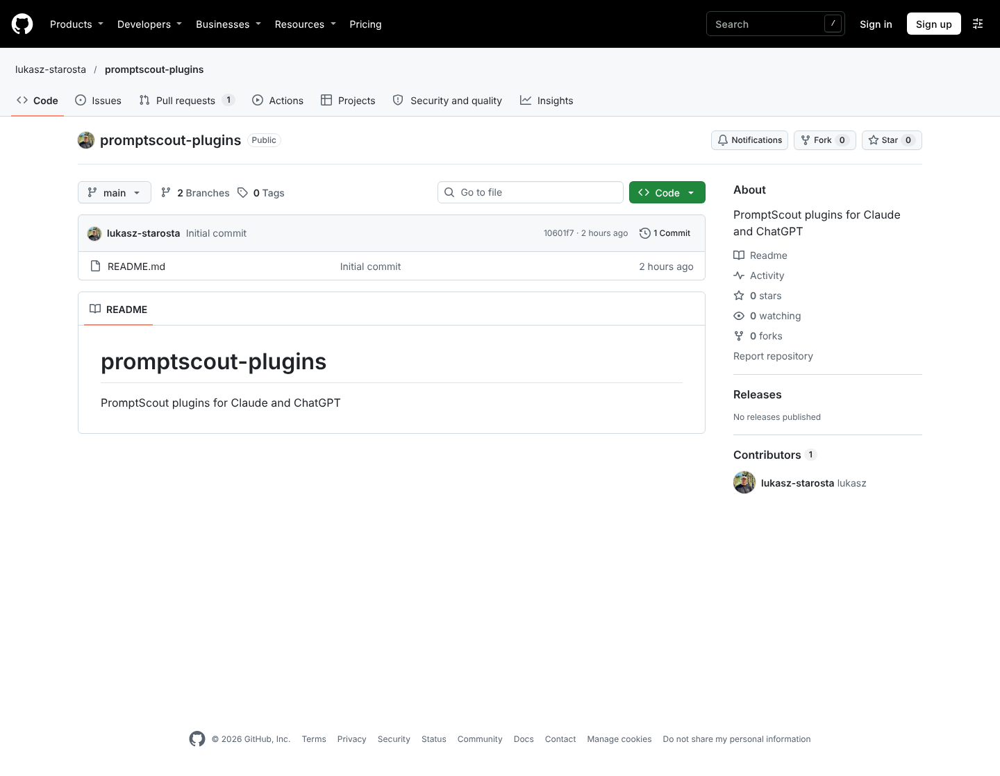
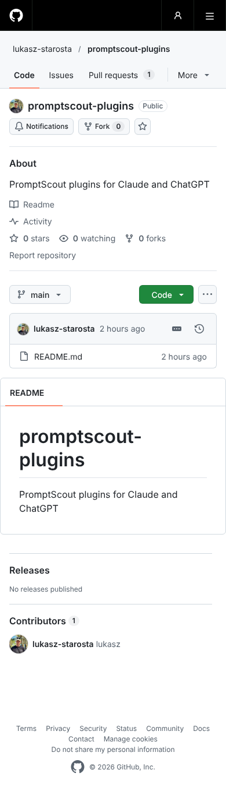
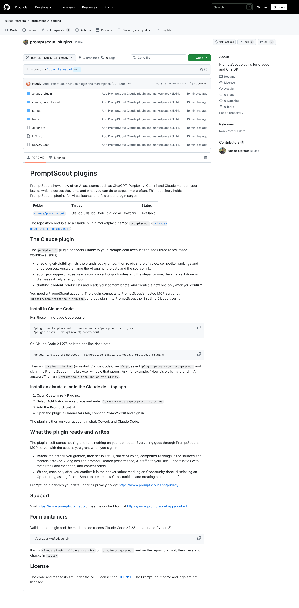
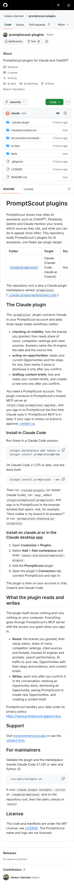
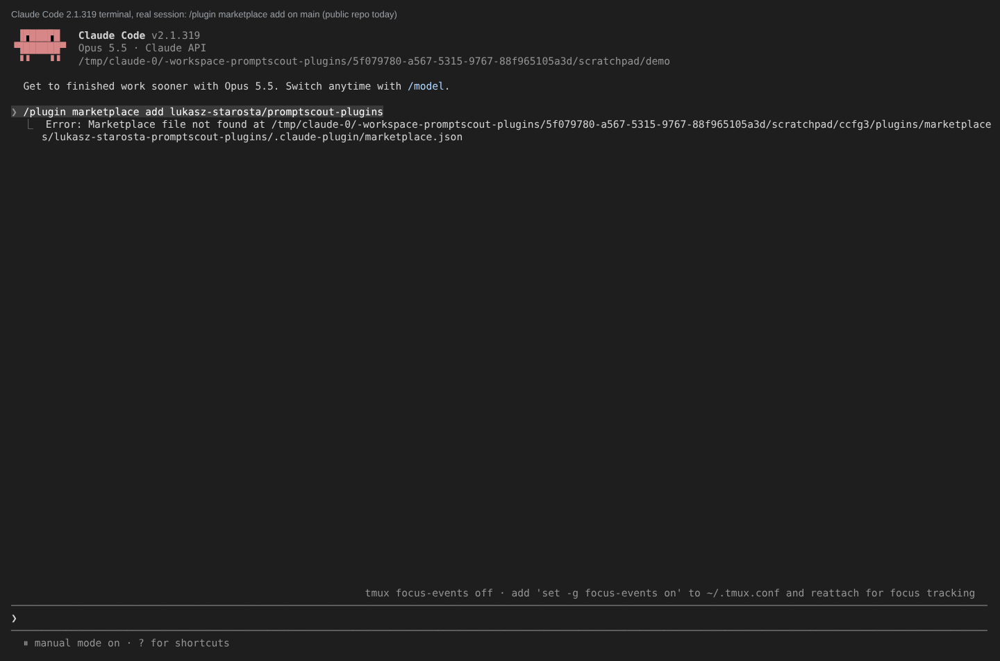
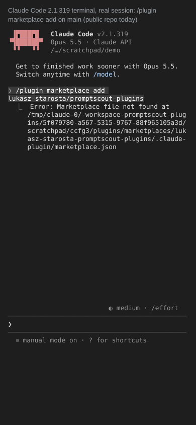
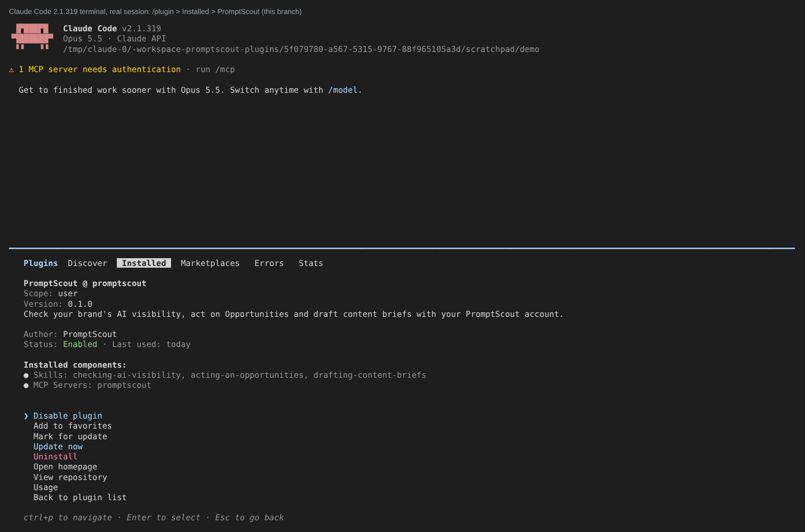
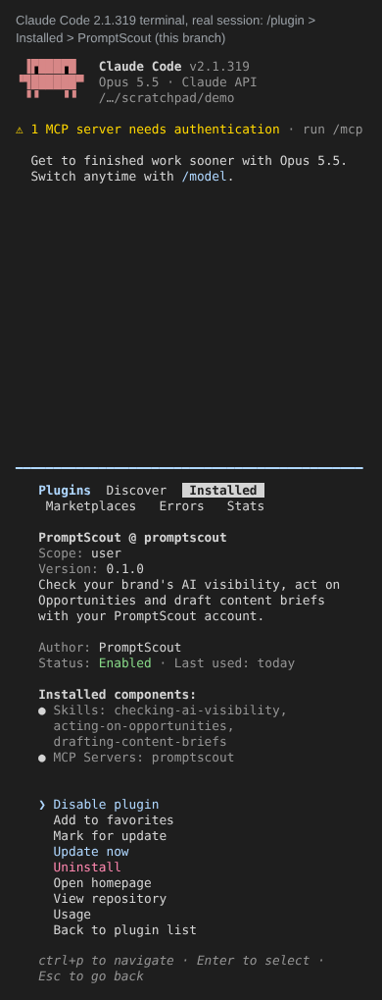
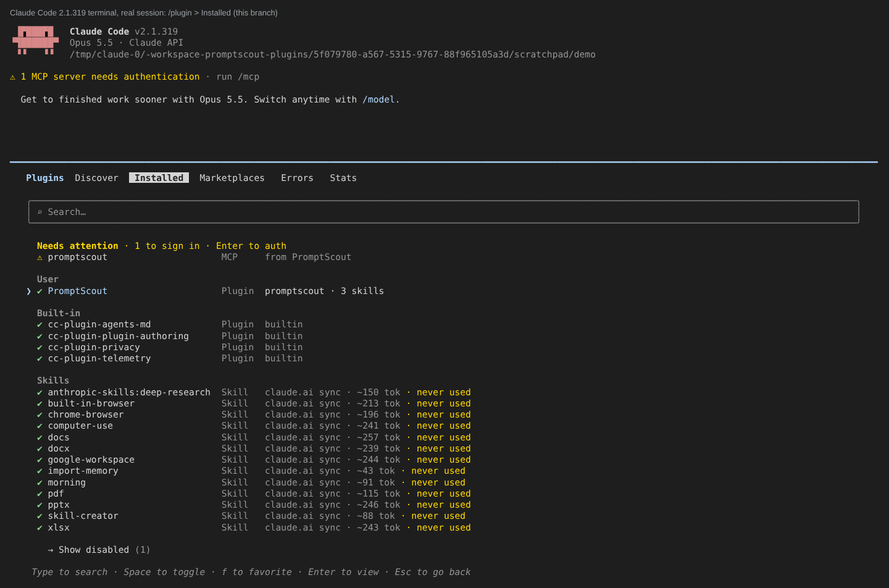
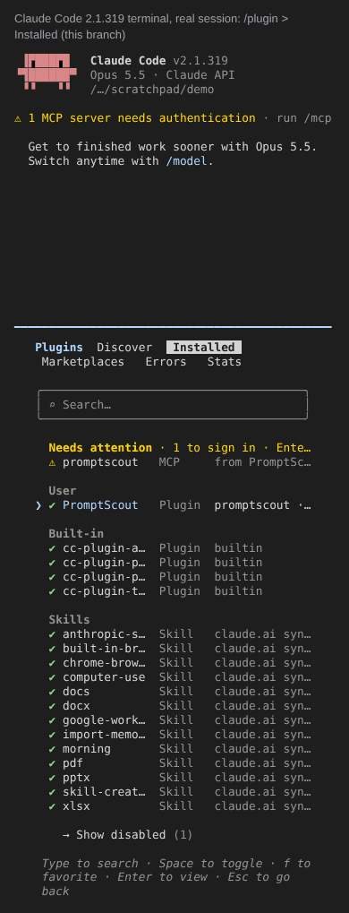

# Claude plugin evidence (SL-1428)

These screenshots show what the public sees once PR #2 merges. Each image links to its PNG file.
The full-size files sit in this folder. See also [examples.md](examples.md) (real Claude
answers) and [pages.json](pages.json).

## README on GitHub

Before is `main` (the public repository today). After is branch `feat/SL-1428-N_38Tzo6XS`. Both
are full-page captures of github.com taken on 2026-11-09.

### Before (main)

| 1440 px | 390 px |
| - | - |
|  |  |

### After (branch)

| 1440 px | 390 px |
| - | - |
|  |  |

## Claude Code `/plugin` panel

These are real interactive Claude Code 2.1.319 sessions, captured from the terminal on
2026-11-09.

### Before (main)

`/plugin marketplace add lukasz-starosta/promptscout-plugins` against the public repository
fails with `Marketplace file not found …/.claude-plugin/marketplace.json`.

| 1440 px | 390 px |
| - | - |
|  |  |

### After: PromptScout details (branch)

`/plugin > Installed > PromptScout` shows the description, author, version, the 3 skills and the
`promptscout` server.

| 1440 px | 390 px |
| - | - |
|  |  |

### After: installed list (branch)

The list shows PromptScout with 3 skills, and the `promptscout` server marked "Enter to auth".

| 1440 px | 390 px |
| - | - |
|  |  |

This folder is evidence for the founder's decision and is not part of the plugin. It can be
deleted before or after merge without affecting the plugin.
